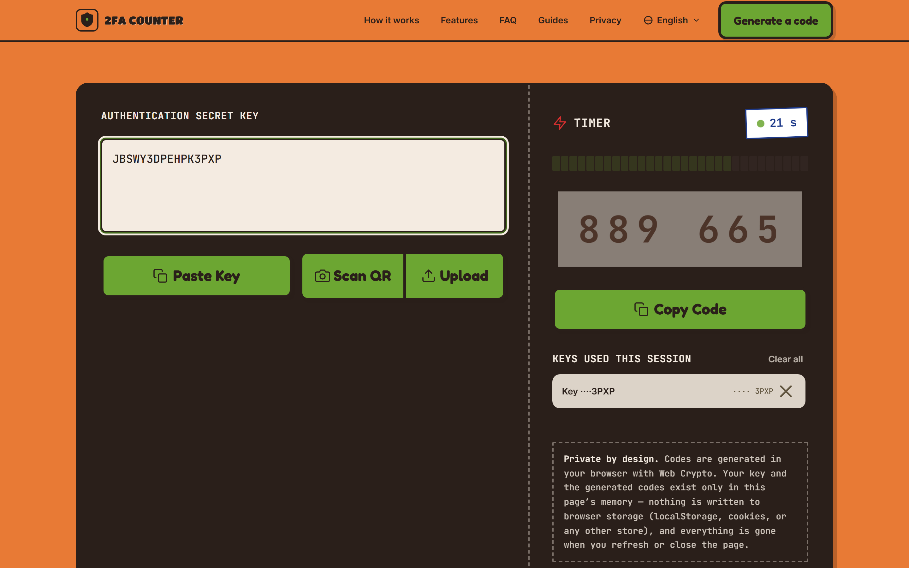
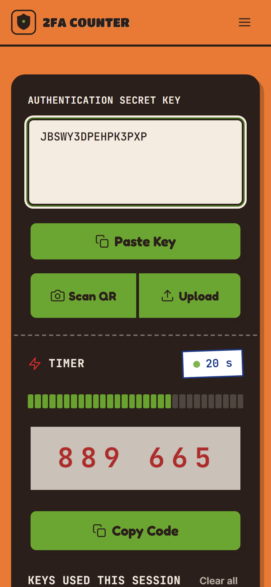

# 2FA COUNTER — 2facounter.com

[](./LICENSE)
[](https://2facounter.com)

A fast, free, private 2FA / authenticator app that runs entirely in the browser.
Paste a secret key (or scan a QR code with the camera / upload a QR screenshot)
and get a live TOTP/HOTP code — generated locally with the Web Crypto API.
Keys are kept in memory only (nothing is written to localStorage, cookies or
any other persistent storage); there are no servers.

<p>
  
</p>
<p>
  
</p>

**Try it: [2facounter.com](https://2facounter.com) · [Privacy policy](https://2facounter.com/privacy/)** —
zero third-party requests: no analytics, no trackers, no CDN scripts; every
asset is served from the site's own domain, and the tool keeps working with
the network disconnected.

## Stack

- [Astro](https://astro.build) (static output) + [Tailwind CSS v4](https://tailwindcss.com)
- Web Crypto (HMAC-SHA-1/256/512) — RFC 6238 / RFC 4226
- `jsqr` for on-device QR decoding (bundled, no CDN)

## Project structure

```text
/
├── public/              # favicon, PWA icons, manifest, service worker
├── src/
│   ├── components/      # Generator, token panel, header/footer, guide layout
│   ├── layouts/         # Base HTML layout (fonts, meta, service worker)
│   ├── pages/           # index, about, contact, privacy, guides/*, preview
│   ├── scripts/         # generator.ts — client-side TOTP/HOTP engine
│   └── styles/          # global.css — Tailwind theme + component primitives
├── tools/               # asset pipelines (favicons, OG card rendering)
├── scripts/             # build helpers (build-favicons.mjs)
├── DESIGN.md            # design system spec (deli/identity theme)
└── e2e-smoke.mjs        # Playwright smoke test suite
```

## Commands

| Command             | Action                                    |
| :------------------ | :---------------------------------------- |
| `npm run dev`       | Starts local dev server (background)      |
| `npm run build`     | Build the production site to `./dist/`    |
| `npm run preview`   | Preview the production build locally      |
| `npm run typecheck` | TypeScript check (`tsc --noEmit`)         |
| `npm run test:e2e`  | Run the Playwright smoke tests (dev server must be running) |

## Search engine verification (post-deploy)

1. Copy `.env.example` → `.env`, paste your `PUBLIC_GSC_TOKEN` and
   `PUBLIC_BING_TOKEN`, rebuild. The verification metas render only when
   non-empty (see the commented block in `src/layouts/Layout.astro`).
2. In Google Search Console: Sitemaps → submit
   `https://2facounter.com/sitemap-index.xml` (Bing takes the same URL).

## AdSense launch runbook

The site currently ships **no ad code** — `public/ads.txt` is a
comment-only placeholder, and the privacy policy states there are no ads.
When ad code is added, the in-source checklist in
`src/pages/privacy.astro` (search "ADSENSE LAUNCH CHECKLIST") lists every
statement that must be updated the same day, plus the EU/EEA/UK consent
management (CMP) requirement. Filling `public/ads.txt` with the real
AdSense publisher ID (`google.com, pub-XXXXXXXXXXXXXXXX, DIRECT, f08c47fec0942fa0`)
is required once the account is active — never publish an invented ID.

## License

The full source of 2FA Counter is released under the
[GNU Affero General Public License v3.0](./LICENSE) (AGPL-3.0-or-later):
anyone may run, study, modify, and redistribute it, and anyone who offers a
modified version as a network service must release that version's source
under the same terms. The 2FA tool itself is fully client-side — secret
keys and generated codes never leave the browser.
